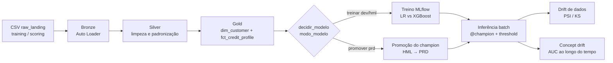
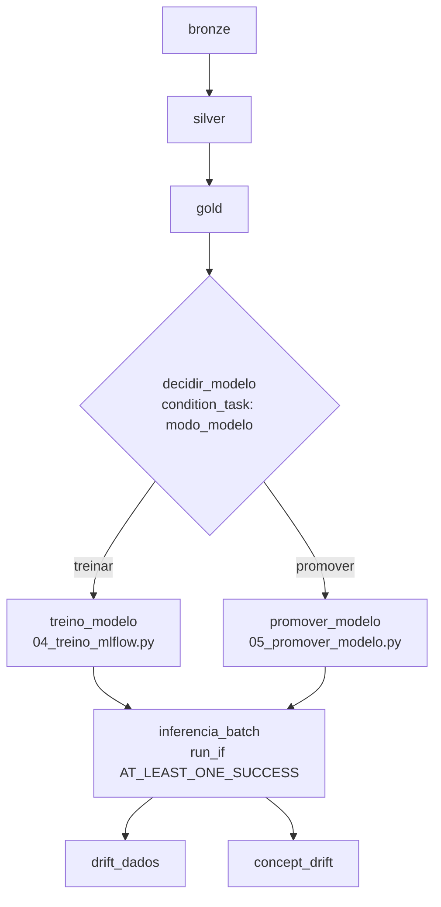
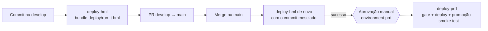

# Documentação Técnica — `risco_credito_databricks`

> Score de risco de crédito ponta a ponta na plataforma Databricks (Medallion + MLflow + Unity Catalog + monitoramento), com promoção controlada **DEV → HML → PRD**.

| Campo | Valor |
|---|---|
| Projeto | `risco_credito_databricks` |
| Autor | Sergio (Data Science — Mezzo) |
| Versão do documento | 1.0 (baseada na última versão do projeto: pipeline com promoção HML → PRD, 14–15/10/2026) |
| Status | Em produção (Databricks Free Edition — ver [Limitações](#13-riscos-limitações-e-decisões-de-arquitetura)) |
| Base de dados | *Give Me Some Credit* (Kaggle): 150.000 clientes de treino e 101.503 de scoring |
| Plataforma | Databricks (Serverless), Unity Catalog, Auto Loader, MLflow, Databricks Asset Bundles, GitHub Actions |

> **Nota de método.** Esta documentação foi construída a partir do histórico do projeto (decisões, notebooks, YAMLs e scripts produzidos nas conversas) e da estrutura de diretórios enviada. Itens inferidos e que precisam ser conferidos contra o código estão marcados com ⚠️ e consolidados na [Seção 16](#16-pontos-a-validar-contra-o-código).

---

## Sumário

1. [Visão geral](#1-visão-geral)
2. [Levantamento do problema](#2-levantamento-do-problema)
3. [Levantamento de hipóteses e perguntas de investigação](#3-levantamento-de-hipóteses-e-perguntas-de-investigação)
4. [Definição do modelo](#4-definição-do-modelo)
5. [Métricas analisadas](#5-métricas-analisadas)
6. [Arquitetura de dados e plataforma](#6-arquitetura-de-dados-e-plataforma)
7. [Estrutura do repositório](#7-estrutura-do-repositório)
8. [Documentação do código por fase](#8-documentação-do-código-por-fase)
9. [Ambientes e promoção HML → PRD](#9-ambientes-e-promoção-do-fonte-dev--hml--prd)
10. [Monitoramento e operação](#10-monitoramento-e-operação)
11. [Boas práticas de engenharia adotadas](#11-boas-práticas-de-engenharia-adotadas)
12. [Governança do modelo](#12-governança-do-modelo)
13. [Riscos, limitações e decisões de arquitetura](#13-riscos-limitações-e-decisões-de-arquitetura)
14. [Lições aprendidas (bugs e correções)](#14-lições-aprendidas-bugs-e-correções)
15. [Runbook: como executar e operar](#15-runbook-como-executar-e-operar)
16. [Pontos a validar contra o código](#16-pontos-a-validar-contra-o-código)
17. [Glossário](#17-glossário)

---

## 1. Visão geral

### 1.1 Objetivo

Construir um pipeline reprodutível que, a partir de dados cadastrais e comportamentais de crédito, **estime a probabilidade de um cliente ficar inadimplente (90+ dias de atraso em 2 anos)** e converta essa probabilidade em uma **decisão operacional** (aprovar / negar), com monitoramento contínuo do modelo.

### 1.2 Resultado em uma página

| Indicador | Resultado |
|---|---|
| Modelo campeão | XGBoost registrado em `{catalog}.gold.credito_risco_xgb@champion` |
| AUC-ROC | **0,866** (gate de promoção exige ≥ 0,80) |
| Threshold operacional | **0,45** (definido em H3) |
| Inadimplência da carteira | 6,68% → **1,76%** com o modelo |
| Taxa de aprovação | **73,1%** |
| Comparação com baseline | Regressão logística, mesma taxa de aprovação: 3,08% de inadimplência |
| Viés relevante | Bom pagador de 18–30 anos é recusado **5,4×** mais que um de 60+ |
| Ponto de equilíbrio financeiro | Modelo se paga enquanto a perda por calote ≥ **4,0×** a margem de um bom cliente |

### 1.3 Posicionamento (importante)

O dataset é público e norte-americano. O projeto é uma **demonstração técnica de plataforma e de MLOps**, não uma recomendação de política de crédito para o mercado brasileiro. Dados agregados do BACEN (SCR) e da ANS entram, quando entram, apenas como contexto externo em monitoramento, nunca como validação do modelo.

### 1.4 Fluxo ponta a ponta



---

## 2. Levantamento do problema

Esta seção descreve **como** o problema deve ser levantado (método reutilizável) e **como foi aplicado** neste projeto.

### 2.1 Método: o que levantar antes de escrever código

| # | Item | Pergunta-guia | Entregável |
|---|---|---|---|
| 1 | Decisão de negócio | Que decisão este projeto sustenta? Quem a toma hoje, sem o modelo? | Frase única: "Decidir *X* para *Y*, em vez de *Z*" |
| 2 | Stakeholders | Quem patrocina, quem usa, quem audita? | Matriz de papéis |
| 3 | Escopo | O que está dentro e fora? | Lista explícita de inclusões/exclusões |
| 4 | Critério de sucesso | Quando dizemos "funcionou"? | Metas numéricas (técnicas e de negócio) |
| 5 | Premissas financeiras | Quanto custa errar para cada lado? | Constantes de custo versionadas |
| 6 | Restrições | Regulação, LGPD, prazo, plataforma, orçamento | Lista de restrições |
| 7 | Dados disponíveis | Fonte, janela, rótulo, qualidade, defasagem do rótulo | Inventário + dicionário de dados |
| 8 | Riscos conhecidos | Viés, vazamento, drift, dependência de rótulo atrasado | Registro de riscos |
| 9 | Questões em aberto | O que depende do negócio e não dos dados? | Lista para validar com o patrocinador |

> **Regra de ouro:** o documento de alinhamento (itens 1–9) é o **primeiro** artefato do projeto, não um registro posterior. Neste projeto ele só foi consolidado depois de haver modelo rodando — foi a principal fonte de retrabalho (ver [Seção 14](#14-lições-aprendidas-bugs-e-correções)).

### 2.2 Aplicação ao projeto

**Decisão em uma frase.** Decidir, para cada solicitação de crédito, se **aprova ou nega**, usando uma probabilidade de inadimplência calibrada, em vez de uma política sem modelo.

**Problema de ML.** Classificação binária supervisionada, com **classe rara** (~6,7% de inadimplentes).

| Item | Definição |
|---|---|
| Alvo | `SeriousDlqin2yrs` — atraso grave (90+ dias) nos 2 anos seguintes (no Gold: `target_dlq_2yrs`) |
| Unidade de análise | Cliente (uma linha por cliente) |
| Features | Uso do crédito rotativo, idade, atrasos (30–59, 60–89, 90+), razão dívida/renda, renda mensal, nº de linhas de crédito, nº de imóveis, nº de dependentes |
| Dados de treino | 150.000 clientes com rótulo (`cs-training.csv`) |
| Dados de scoring | 101.503 clientes sem rótulo (`cs-test.csv`), usados só em inferência |
| Qualidade | ~19,82% de nulos em `monthly_income`; outliers em contagens de atraso (flag `has_delinquency_outlier`) |

**Critérios de sucesso.**

| Dimensão | Critério |
|---|---|
| Discriminação | AUC e KS acima da meta (referência de mercado para este dataset: 0,86–0,87) |
| Calibração | Probabilidade utilizável como probabilidade (Brier e erro de calibração reportados) |
| Negócio | Redução da inadimplência da carteira sem derrubar a aprovação abaixo do piso (70%) e com impacto financeiro líquido positivo |
| Justiça | Desproporção entre grupos medida e documentada |
| Engenharia | Reprodutível, versionado, testado, promovido por CI/CD, monitorado |

**Premissas financeiras.** Custos de aprovar mau pagador e de negar bom pagador ficam **em um único arquivo**: `src/config/business_params.py`. Nenhum notebook ou módulo pode redefinir esses valores.

**Restrições.** Domínio regulado (rastreabilidade e auditoria do artefato em produção), rótulo só se realiza após 2 anos (limita monitoramento de concept drift real), Databricks Free Edition (um workspace, isolamento por catálogo).

**Riscos mapeados.** Viés por faixa etária; probabilidades distorcidas por `scale_pos_weight`; colisão de IDs entre treino e scoring; dependência de um `@champion` existente antes da inferência; drift sem rótulo real.

**Questões em aberto para o negócio** (a registrar no ADR quando respondidas): valor real das perdas e margens; existência de faixa de "revisão manual" entre aprovar e negar; política para a faixa etária 18–30.

---

## 3. Levantamento de hipóteses e perguntas de investigação

### 3.1 Método: como formular

**Hipótese ≠ pergunta.**

| | Hipótese (H) | Pergunta de investigação (Q) |
|---|---|---|
| Natureza | Afirmação **falsificável**, com direção esperada | Investigação aberta, sem direção prévia |
| Exemplo | "Uso de rotativo alto aumenta a inadimplência" | "Qual o threshold ótimo sob custo assimétrico?" |
| Resultado | Confirmada / Contrariada / Inconclusiva | Número, gráfico ou tabela |

**Passo a passo para criar hipóteses:**

1. **Domain prior.** O que um analista de crédito experiente já suspeita antes de abrir a base? (uso de limite, endividamento, histórico de atraso).
2. **Dado disponível.** Qual coluna do dicionário de dados testa a hipótese? A hipótese deve citar **a coluna exata** (evita ambiguidade).
3. **Critério de erro antes de rodar.** Defina qual resultado *contraria* a hipótese. Depois de congelada, qualquer mudança é registrada como mudança, nunca reescrita silenciosa.
4. **Método estatístico justificado pela distribuição.** Ex.: com outliers, Spearman em vez de Pearson.
5. **Classificar por papel**, antes de gerar as hipóteses, em duas camadas:
   - **Camada 1 — Confiança no modelo:** o modelo aprendeu algo que faz sentido de negócio?
   - **Camada 2 — Decisão operacional:** dado que o modelo é confiável, **que corte usar e vale a pena?**
6. **Onde roda.** Hipóteses são **análises de DEV**, executadas manualmente; HML e PRD só executam o modelo.

### 3.2 Hipóteses do projeto (H1–H4)

Implementadas em `notebooks/ml/01_hipoteses_h1_h4.py` com lógica em `src/models/hypothesis_validation.py`. O resultado é persistido em `gold.gold_hypotheses_validation` (exatamente 4 linhas, cada uma com status, métrica e evidência).

| Camada | ID | Enunciado | Método | Resultado | Status |
|---|---|---|---|---|---|
| 1 — Confiança | **H1** | Uso do rotativo perto do limite aumenta a inadimplência | Spearman entre a feature e seu próprio SHAP | ρ = 0,879 | Confirmada |
| 1 — Confiança | **H2** | Dívida/renda pesa mais que idade | Comparação de \|SHAP\| médio | Idade 0,245 vs. dívida/renda 0,153 (1,6×) | **Contrariada** |
| 2 — Decisão | **H3** | Existe um threshold que reduz a inadimplência sem derrubar a aprovação | Menor corte que respeita piso de aprovação (70%) | Corte 0,45: 6,68% → 1,76%; aprovação 73,1% | Confirmada |
| 2 — Decisão | **H4** | O modelo evita mais perdas em R$ do que custa recusar bons pagadores | Perda evitada vs. custo de oportunidade | Break-even em 4,0× a margem de um bom cliente | Confirmada |

> **Por que H2 importa.** O resultado contrariado (idade pesando quase o dobro) foi o gatilho da análise de viés por faixa etária (Q3). Hipótese contrariada é achado, não falha.

### 3.3 Perguntas de investigação (Q1–Q4)

Implementadas em `notebooks/ml/02_vies_threshold_roi.py` com lógica em `src/models/bias_roi_validation.py`.

| ID | Pergunta | Saída |
|---|---|---|
| **Q1** | Quais variáveis mais pesam (ranking SHAP)? H1/H2 aparecem no top-5? | Ranking de importância |
| **Q2** | Qual o threshold ótimo sob **custo assimétrico**? | Threshold que minimiza custo esperado |
| **Q3** | O modelo é estável / enviesado por faixa de idade e renda? | FPR/FNR por grupo, regra 4/5, IC de Wilson |
| **Q4** | Qual o impacto financeiro (R$) vs. política atual? | Perda evitada, custo de oportunidade, impacto líquido |

> **H3 ≠ Q2 por desenho.** H3 usa o menor threshold que respeita o piso de aprovação (teste simples da hipótese). Q2 minimiza custo esperado (decisão ótima). Por isso H4 e Q4 podem divergir em R$ sem que haja bug; as **constantes** é que são únicas.

### 3.4 Achados de viés (Q3) e calibração

| Achado | Valor |
|---|---|
| Bom pagador recusado, 18–30 anos | 44,5% |
| Bom pagador recusado, 60+ anos | 8,2% (razão de 5,4×) |
| Inadimplência observada, 18–30 vs. 60+ | 12,0% vs. 2,8% (parte do viés é risco real) |
| Probabilidade bruta (com `scale_pos_weight`) | 31,5% previsto vs. 6,7% observado → **superestima** |
| Correção | Calibração isotônica (ajustada em metade do teste, avaliada na outra metade); não altera a ordenação |
| Experimento | Treino sem a variável idade, para separar o viés da variável do viés por proxies |

---

## 4. Definição do modelo

### 4.1 Pergunta de modelagem

> "Dadas as características de crédito de um cliente, qual a probabilidade de atraso grave em 2 anos, e qual decisão (aprovar/negar) maximiza valor respeitando o piso de aprovação?"

### 4.2 Candidatos e regra de escolha

A escolha é **por regra definida antes de ver os resultados**, não por preferência (`notebooks/ml/04_treino_mlflow.py`).

| Modelo | Papel | Tratamento de desbalanceamento | Pré-processamento |
|---|---|---|---|
| Regressão Logística | Baseline interpretável | `class_weight="balanced"` | `SimpleImputer(strategy="median")` (por causa dos ~19,8% de nulos em renda) |
| XGBoost | Modelo principal | `scale_pos_weight` | Trata nulos nativamente |

**Hiperparâmetros do XGBoost:** `n_estimators=300`, `max_depth=4`, `learning_rate=0,05`, `subsample=0,8`, `colsample_bytree=0,8`, `eval_metric="auc"`, `random_state=42`.

**Regra de decisão:**

```text
diferença = AUC(XGBoost) − AUC(Regressão Logística)
se |diferença| < MARGEM_EMPATE_TECNICO  → vence a Regressão Logística (interpretável)
senão                                    → vence o de maior AUC
```

O vencedor é registrado no Unity Catalog com alias `@champion` (e `@challenger` para o candidato em avaliação).

### 4.3 Decisões de modelagem e justificativas

| Decisão | Justificativa |
|---|---|
| Class weighting em vez de SMOTE | Evita sintetizar clientes; mantém a distribuição real; justificado e documentado |
| Calibração isotônica **antes** de fixar threshold | `scale_pos_weight` melhora a separação mas distorce a probabilidade; threshold e R$ usam a probabilidade como real |
| Threshold por custo/piso, não 0,5 | A decisão é econômica, não estatística |
| Carregar o modelo pelo *flavor* nativo (xgboost/sklearn), não `pyfunc` genérico | Evita erro silencioso de calibração; a tag `algoritmo` na versão informa qual flavor usar |
| SHAP para explicabilidade | Valida H1/H2 e dá explicação por decisão |
| Assinatura e `input_example` no log do modelo | Contrato de entrada/saída auditável |
| Reprodutibilidade contra o `@champion` | Toda validação recalcula a métrica e compara com a registrada; diverge → trava |

### 4.4 Decisão (probabilidade → negócio)

`src/ml/decisao.py` expõe `classificar_decisao()`, que transforma probabilidade + threshold em **aprovado/negado**, validando que a probabilidade está em `[0,1]`. O threshold operacional é parametrizado no notebook de inferência (`threshold_aprovacao`).

> ⚠️ O default do widget no notebook de inferência já foi 0,56 enquanto o corte definido em H3 é **0,45**. Em jobs, sobrescrever explicitamente ou alinhar o default ao valor oficial (ver [Seção 16](#16-pontos-a-validar-contra-o-código)).

---

## 5. Métricas analisadas

### 5.1 Quadro geral

| Família | Métrica | Onde é calculada | Para quê |
|---|---|---|---|
| Discriminação | **AUC-ROC** | `04_treino_mlflow.py`, gate HML | Poder de ordenar bons e maus |
| Discriminação | **KS** | `04_treino_mlflow.py` | Separação máxima entre distribuições |
| Discriminação | **Recall @ precisão-alvo** | `04_treino_mlflow.py` | Captura de maus pagadores com precisão mínima |
| Calibração | **Brier** | `bias_roi_validation.py` | Qualidade da probabilidade |
| Calibração | **Erro médio de calibração** + curva de confiabilidade | `bias_roi_validation.py` | Bruta vs. isotônica |
| Decisão | **Taxa de aprovação** | H3 / Q2 | Piso operacional (70%) |
| Decisão | **Inadimplência da carteira** (com/sem modelo) | H3 / Q4 | Efeito do corte |
| Negócio | **Perda evitada, custo de oportunidade, impacto líquido, break-even** | H4 / Q4 | Valor em R$ |
| Justiça | **FPR/FNR por faixa**, **regra 4/5**, **IC de Wilson** | Q3 | Desproporção entre grupos |
| Explicabilidade | **\|SHAP\| médio**, correlação de Spearman feature×SHAP | Q1 / H1 / H2 | Coerência de negócio |
| Monitoramento | **PSI** (+ KS) por feature e score | `01_drift_dados.py` | Data drift |
| Monitoramento | **Queda de AUC** | `02_concept_drift.py` | Concept drift |

### 5.2 Limiares de leitura

| Métrica | Leitura |
|---|---|
| AUC no gate de promoção | **≥ 0,80** (campeão atual: 0,8656) |
| PSI (convenção de mercado) | < 0,10 estável · 0,10–0,25 moderado · > 0,25 severo ⚠️ confirmar limiares em `classificar_psi()` |
| Concept drift | Queda de AUC acima do limite configurado em `avaliar_queda_auc()` ⚠️ confirmar valor |
| Regra 4/5 | Razão entre taxas de aprovação de grupos < 0,8 sinaliza desproporção |

### 5.3 Escolha de métrica estatística

A escolha deve ser **justificada pela distribuição**: Spearman (não Pearson) em H1 por causa de outliers; Pearson oscilava entre execuções. O **PSI trata inflação de zeros** explicitamente (há teste unitário para esse caso).

---

## 6. Arquitetura de dados e plataforma

### 6.1 Medallion

| Camada | Conteúdo | Quem escreve | Regras |
|---|---|---|---|
| **Raw (landing)** | CSVs em volume do Unity Catalog, em subpastas `training/` e `scoring/` | Carga manual/seed (dados **não** vão no Git) | Nunca ler `training` e `scoring` com um glob único (contamina o Bronze) |
| **Bronze** | Dado bruto ingerido por Auto Loader, uma tabela por dataset | `01_bronze.py` → `src/ingestion/bronze.py` | Sem transformação de negócio; schema e checkpoint em volumes |
| **Silver** | Dado limpo e padronizado, nomes de colunas unificados | `02_silver.py` → `src/ingestion/silver.py` | Contagem pós-carga obrigatória (erro se processar 0 linhas) |
| **Gold** | Modelo estrela: `dim_customer`, `fct_credit_profile`; une treino e scoring | `03_gold` → `src/features/gold.py` | Única camada que traduz vocabulário para os notebooks de análise (`target_dlq_2yrs`, `revolving_utilization`...) |
| **ML** | Predições, monitoramento, hipóteses | Notebooks de `ml/` e `monitoracao/` | Schema `ml` criado antes, por script de setup |

### 6.2 Unity Catalog por ambiente

| Ambiente | Catálogo | Schemas | Volumes |
|---|---|---|---|
| DEV | `credito_dev` | `bronze`, `silver`, `gold`, `ml` | `bronze.raw_landing`, `bronze.checkpoints`, `bronze.schemas`, `silver.checkpoints` |
| HML | `credito_hml` | idem | idem |
| PRD | `credito_prd` | idem | idem |

Modelo registrado em `{catalog}.gold.credito_risco_xgb` com aliases `champion` e `challenger`.

> **Mesmos notebooks em todos os ambientes.** O que muda é **apenas o catálogo**, injetado pelo `target` do bundle (parâmetro `catalog`). Nenhuma alteração de código é necessária entre ambientes.

### 6.3 Chave e IDs

Scoring recebe offset de `10.000.000` nos IDs para evitar colisão com o treino na Gold (a colisão silenciosa já aconteceu — ver [Seção 14](#14-lições-aprendidas-bugs-e-correções)). Toda união entre fontes exige verificar **sobreposição de faixa de IDs** antes do join e teste de unicidade da chave.

### 6.4 Dicionário de dados (fonte única)

- `src/config/data_dictionary.py` é **a única fonte de verdade**; os `COMMENT` e tags do Unity Catalog são aplicados por `apply_all()` ao final dos notebooks de pipeline.
- `docs/dicionario_de_dados.md` é **gerado**, nunca editado à mão.
- A flag `--check` valida em CI que o documento está sincronizado.
- Cobre Silver (`give_me_some_credit`, `give_me_some_credit_scoring`) e Gold (`dim_customer`, `fct_credit_profile`). `target_default_2yrs` é opcional no scoring.

---

## 7. Estrutura do repositório

```text
risco-credito-databricks/
├── databricks.yml                # Bundle: variáveis e targets dev/hml/prd
├── pyproject.toml / uv.lock      # Dependências e configuração de ferramentas (ruff, pytest)
├── .pre-commit-config.yaml       # Hooks (formatação 100 colunas, lint, higiene de notebooks)
├── README.md / CHANGELOG.md / LICENSE
├── risco-credito-databricks.code-workspace
├── .github/workflows/ci.yaml     # CI/CD: qualidade → deploy-hml → deploy-prd
├── resources/                    # Definição do Job (risco_credito_pipeline.yml)
├── notebooks/
│   ├── ingestao/                 # 00_reset, 01_bronze, 02_silver, 03_gold
│   ├── ml/                       # 01_hipoteses, 02_vies_threshold_roi, 03_inferencia_batch,
│   │                             # 04_treino_mlflow, 05_promover_modelo
│   ├── monitoracao/              # 01_drift_dados, 02_concept_drift
│   ├── ead/                      # 01_eda_bronze, 02_eda_silver (exploração manual)
│   ├── sql/                      # DDL puro
│   └── outros/                   # ⚠️ auxiliares (confirmar conteúdo)
├── src/                          # Lógica de negócio, testável, estrutura "flat"
│   ├── config/                   # business_params.py, data_dictionary.py
│   ├── ingestion/                # bronze.py, silver.py, maintenance.py
│   ├── features/                 # gold.py
│   ├── quality/                  # profiling.py
│   ├── models/                   # hypothesis_validation.py, bias_roi_validation.py
│   ├── ml/                       # decisao.py
│   └── monitoring/               # data_drift.py, concept_drift.py
├── tests/                        # Espelha src/ um-para-um
├── scripts/
│   ├── check_hml_gate.py         # Gate de promoção (AUC do champion em HML)
│   ├── check_preflight.py        # Verificações pré-deploy
│   ├── check_prd_model.py        # Smoke test do modelo em PRD
│   ├── check_notebook_hygiene.py # Bloqueia %uv sync / %pip install em notebooks
│   ├── formatar.sh / setup_terminal.sh
│   └── setup/                    # Infra: 00_infra_<env>.sql + seed_hml_volumes_inicial.ipynb
├── docs/                         # dicionario_de_dados.md (gerado), guias das fases
├── data/ · imagens/              # Dados locais (fora do Git) e imagens do README
└── .temp/ · .temp_del/           # Rascunhos locais (fora do Git — ver nota)
```

> **Nota de higiene.** `.temp`, `.temp_del`, `dist/`, `*.egg-info`, `.databricks/`, `.pytest_cache/`, `.ruff_cache/`, `.venv/` e `__pycache__/` não devem ser versionados nem sincronizados no bundle. Existe uma `.temp_del` dentro de `src/` (visível na estrutura enviada): remova-a ou mova-a para fora de `src/` para não entrar no pacote. Em `databricks.yml`, mantenha `sync.exclude` com `.venv/**` (um `.venv` sincronizado já causou falha `RESOURCE_DOES_NOT_EXIST` na Silver).

### 7.1 Regras transversais

1. **Notebook nunca implementa lógica de negócio.** Lê *widgets*, chama funções de `src/`, exibe e registra logs.
2. **Funções de `src/` são puras quando possível** (numpy/pandas, sem Spark/`dbutils`), para rodar em `pytest` sem cluster.
3. **Notebook destrutivo nunca entra no Job recorrente** (`00_reset_ambiente.py` é manual).
4. **Tradução de nomes de coluna entre camadas acontece só em `src/features/gold.py`.**
5. **Constante de negócio usada em mais de um lugar vive só em `src/config/business_params.py`.**
6. **Infraestrutura (schemas, volumes) é criada antes, em script de setup**, nunca dentro dos notebooks do pipeline.
7. **Notebooks não gerenciam ambiente** (`%uv sync` / `%pip install` só manualmente em DEV; o hook de higiene bloqueia o commit).
8. **Resolução de caminhos** por `_find_repo_root()` e `sys.path.insert(0, repo_root)` (*insert*, não *append*, para priorizar o código do repositório sobre qualquer cópia instalada).

---

## 8. Documentação do código por fase

Convenção: cada programa é descrito por **fase → o que faz → entradas/parâmetros → saídas → regras**.

### 8.1 Fase 0 — Infraestrutura (antes do pipeline)

| Programa | O que faz | Observações |
|---|---|---|
| `scripts/setup/script-<env>/00_infra_<env>.sql` | Cria schemas (`bronze`, `silver`, `gold`, `ml`) e volumes (`raw_landing`, `checkpoints`, `schemas`) de forma **idempotente** | Rodar no **SQL Editor** do Databricks (não no kernel Python local). Para PRD, copiar trocando `credito_hml` por `credito_prd` |
| `scripts/setup/.../seed_hml_volumes_inicial.ipynb` | Copia os CSVs do volume de DEV para o `raw_landing` do ambiente destino e limpa checkpoints | Necessário porque os dados **não** estão no Git. Rodar só quando precisar recarregar |

### 8.2 Fase 1 — Ingestão (`notebooks/ingestao/`)

| Notebook | Módulo `src/` | O que faz | Parâmetros | Saída |
|---|---|---|---|---|
| `00_reset_ambiente.py` | `ingestion/maintenance.py` (`reset_legacy_environment`) | **Destrutivo**: `DROP TABLE` e limpeza de checkpoints legados | `catalog`, `confirmar` | Ambiente limpo. **Nunca em Job recorrente** |
| `01_bronze.py` | `ingestion/bronze.py` (`run_bronze_ingestion`) | Auto Loader lê `raw_landing/<dataset>/` e grava Bronze (Delta) | `catalog`, `dataset` (`training`/`scoring`) | Tabela Bronze por dataset |
| `02_silver.py` | `ingestion/silver.py` (`run_silver_ingestion`) | Limpeza e padronização Bronze → Silver (streaming com checkpoint). Mapeamento único de nomes de colunas | `catalog`, `dataset` | Silver por dataset. **Falha com `RuntimeError`** se processar 0 linhas (checkpoint obsoleto) |
| `03_gold` (`.ipynb`) | `features/gold.py` | Modelo estrela, une treino e scoring (offset de ID no scoring), traduz vocabulário, aplica dicionário de dados | `catalog` | `dim_customer`, `fct_credit_profile` |

### 8.3 Fase 2 — Qualidade e exploração (`notebooks/ead/` + `src/quality/`)

Fora do Job agendado; opcional; não bloqueia as fases seguintes. **EDA é só diagnóstico (não altera dataframes)**; os tratamentos são materializados na Silver.

| Notebook | O que faz |
|---|---|
| `01_eda_bronze.py` | Completude, duplicidade por `customer_id`, cardinalidade |
| `02_eda_silver.py` | Distribuição do alvo, flags de qualidade (`is_monthly_income_null`, `has_delinquency_outlier`), padrão de ausência (MCAR/MAR/MNAR) |

`src/quality/profiling.py` concentra as funções de completude, cardinalidade e flags.

### 8.4 Fase 3 — Hipóteses e análises de DEV (`notebooks/ml/`)

| Notebook | Módulo | O que faz | Saída |
|---|---|---|---|
| `01_hipoteses_h1_h4.py` | `models/hypothesis_validation.py` | Carrega a Gold de treino (`load_gold_training_data`), valida H1–H4, persiste evidências | `gold.gold_hypotheses_validation` (4 linhas) |
| `02_vies_threshold_roi.py` | `models/bias_roi_validation.py` | Carrega o `@champion` do Registry, responde Q1–Q4, calibração, comparação com logística na mesma taxa de aprovação, log no MLflow | Gráficos, tabelas e métricas no MLflow |

> São **análises de DEV, rodadas manualmente**. HML e PRD não as executam. Na primeira execução sem `@champion`, o notebook treina um baseline e o registra; na segunda, deve imprimir "Modelo carregado do Registry" (prova de que não retreina).

### 8.5 Fase 4 — Treino e registro (`04_treino_mlflow.py`)

| Item | Descrição |
|---|---|
| Entrada | Gold de treino (`catalog`); `gerar_shap` (padrão `false` em pipeline) |
| Passos | (1) split treino/teste, (2) treina Regressão Logística e XGBoost em *runs* MLflow, (3) calcula AUC, KS, recall@precisão, (4) aplica a regra de decisão, (5) loga modelo com assinatura e `input_example`, (6) registra `{catalog}.gold.credito_risco_xgb` com tag `algoritmo` e aliases |
| Saída | Versão registrada com `@champion`/`@challenger` |
| Roda em | **DEV e HML** (`modo_modelo = treinar`). **Nunca em PRD** |

### 8.6 Fase 5 — Promoção do modelo (`05_promover_modelo.py`, só PRD)

Copia a versão `champion` do catálogo de origem (`credito_hml`) para o catálogo do ambiente (`credito_prd`), **sem retreinar**.

| Item | Descrição |
|---|---|
| Parâmetros | `catalog`, `source_catalog`, `schema` (`gold`), `model_name` (`credito_risco_xgb`), `alias` (`champion`) |
| Idempotência | Se a versão de origem já foi promovida, reaproveita e só garante o alias |
| Linhagem | Tags na versão de PRD: modelo, versão e run de origem, `auc_roc_hml`, data. **Copia também as tags originais** (a inferência depende de `algoritmo`) |
| Falha explícita | Se o alias `champion` não existir em HML |
| Rollback | Reapontar o alias `champion` para a versão anterior |

### 8.7 Fase 6 — Inferência batch (`03_inferencia_batch.py`)

| Item | Descrição |
|---|---|
| Entrada | Gold de scoring; `@champion` do ambiente; `threshold_aprovacao` |
| Passos | Carrega o modelo pelo *flavor* nativo conforme a tag `algoritmo`; calcula probabilidade; aplica `classificar_decisao()`; grava predições na camada `ml` |
| Execução | `run_if: AT_LEAST_ONE_SUCCESS` (roda se treinou **ou** promoveu) |
| Pré-requisito | Existir um `@champion` no ambiente |

### 8.8 Fase 7 — Monitoramento (`notebooks/monitoracao/` + `src/monitoring/`)

| Notebook | Módulo | O que faz | Observações |
|---|---|---|---|
| `01_drift_dados.py` | `data_drift.py` (`calcular_psi`, `classificar_psi`) | PSI/KS entre a distribuição de treino (referência) e o lote recém-pontuado | Ignora `NaN`; trata inflação de zeros; classifica estável/moderado/severo |
| `02_concept_drift.py` | `concept_drift.py` (`avaliar_queda_auc`, `gerar_lote_sintetico`) | Compara AUC ao longo do tempo | `simulation_mode="true"` por padrão: dataset estático, sem desfecho real. Ver [Seção 10](#10-monitoramento-e-operação) |

As funções de `src/monitoring/` são puras (numpy/pandas), sem Spark nem `dbutils`.

### 8.9 `src/` — módulos de apoio

| Módulo | Responsabilidade |
|---|---|
| `config/business_params.py` | Constantes financeiras (fonte única) usadas em H4 e Q2/Q4 |
| `config/data_dictionary.py` | Dicionário de dados e `apply_all()`; flag `--check` |
| `models/hypothesis_validation.py` | Validação H1–H4 (funções puras recebem DataFrames) |
| `models/bias_roi_validation.py` | Q1–Q4, `calibration_analysis`, `compare_with_logistic`, `financial_impact` |
| `ml/decisao.py` | `classificar_decisao()` |
| `features/gold.py` | Star schema e tradução de nomenclatura |
| `quality/profiling.py` | Perfis de qualidade |

### 8.10 `tests/`

Espelha `src/`, roda no CI a cada PR, sem cluster (Spark simulado quando necessário).

| Teste | Cobre |
|---|---|
| `test_decisao.py` | Limites do threshold; probabilidade fora de `[0,1]` |
| `test_data_drift.py` | PSI zero em distribuições idênticas, cresce com deslocamento, ignora `NaN`, limiares moderado/severo, inflação de zeros |
| `test_data_dictionary.py` | Dez testes do dicionário e da geração do `.md` |
| Testes de H1/calibração | Casos Pearson × Spearman e comportamento da calibração (reproduzem bugs reais) |

> **Prática:** todo bug encontrado vira um teste que o reproduz antes da correção.

### 8.11 `scripts/` (qualidade e governança do deploy)

| Script | Fase | O que faz |
|---|---|---|
| `check_notebook_hygiene.py` | Commit / CI | Falha se houver `%uv sync` ou `%pip install` fora de comentário em notebooks versionados |
| `check_preflight.py` | Pré-deploy | Verificações antes do deploy ⚠️ confirmar lista exata |
| `check_hml_gate.py` | Antes de PRD | Valida o **`@champion`** de HML: AUC-ROC ≥ 0,80 (lido das tags da versão no Unity Catalog) |
| `check_prd_model.py` | Pós-deploy PRD | Smoke test: PRD tem `@champion` e tags de linhagem; usa `tracking_uri="databricks"` |
| `formatar.sh` / `setup_terminal.sh` | Dev local | Formatação e preparo do terminal |

### 8.12 `resources/risco_credito_pipeline.yml` — orquestração



- **Um único job** para todos os ambientes; a ramificação é por variável de bundle (`modo_modelo`).
- `simulation_mode` vem de variável do bundle (não fica fixo no YAML).
- Notebooks de análise (H1–H4, viés/ROI), reset e EDA **ficam fora** do job.
- ⚠️ Os `task_key` das tarefas de ingestão (bronze/silver para `training` e `scoring`) seguem o YAML do repositório; confirmar os nomes. Existe também a execução de ingestão de scoring separada, diferenciada apenas pelo parâmetro `dataset`.

---

## 9. Ambientes e promoção do fonte (DEV → HML → PRD)

### 9.1 Princípios

1. **Promover artefato, não retreinar.** Em PRD usa-se **exatamente** o modelo validado em HML (rastreabilidade e auditoria — requisito de domínio regulado).
2. **Mesmo código, ambientes distintos.** O único *switch* é o catálogo (e `modo_modelo`).
3. **Infra como pré-requisito**, fora do pipeline.
4. **Gate automático + aprovação humana** antes de produção.
5. **O que vai para PRD é o commit que o HML acabou de validar.**

### 9.2 Modelo de branches e fluxo

| Branch | Ambiente | Gatilho |
|---|---|---|
| feature/* | — | PR para `develop` roda qualidade |
| `develop` | **HML** | Push com mudança relevante (notebooks, `src/`, `resources/`, `databricks.yml`, `scripts/`, workflow) |
| `main` | **PRD** | Merge do PR `develop → main`; ou disparo manual (`workflow_dispatch`) |



### 9.3 Jobs do `ci.yaml`

| Job | Quando roda | O que faz |
|---|---|---|
| `detect-changes` | Sempre | Filtro de caminhos; saídas `relevante`, `pipeline` e `ci` |
| Qualidade (pre-commit, ruff, pytest) | PR/push | Lint, formatação (100 colunas), higiene de notebooks, testes unitários |
| `deploy-hml` | Push em `develop` (relevante ou mudança do workflow) **e** push em `main` (relevante); ou manual | `environment: hml`; `concurrency` (`deploy-hml`, sem cancelar) evita execuções simultâneas; `bundle deploy -t hml` e `bundle run -t hml`; valida gate |
| `deploy-prd` | Push em `main` (relevante) ou manual na `main`, **depois** do `deploy-hml` do mesmo commit (`needs: [detect-changes, deploy-hml]`) | `environment: prd` com **required reviewers**; revalida `check_hml_gate.py`; `bundle deploy -t prd`; copia dados brutos HML → PRD; executa o job (que **promove** o modelo); roda `check_prd_model.py`; `concurrency` impede dois deploys de PRD |

> Se o HML falhar ou for pulado, o PRD é pulado. Mudança só no `ci.yaml` na `main` não dispara HML/PRD (por desenho); o encadeamento completo é exercitado no próximo merge com código relevante ou por **Run workflow** manual na `main`.

### 9.4 Parâmetros do bundle (`databricks.yml`)

| Variável | DEV/HML | PRD | Função |
|---|---|---|---|
| `catalog` | `credito_dev` / `credito_hml` | `credito_prd` | Isola o ambiente |
| `modo_modelo` | `treinar` | **`promover`** | Define a ramificação do job |
| `catalogo_origem_modelo` | — | `credito_hml` | De onde o `@champion` é promovido |
| `simulation_mode` | `"true"` | `"true"` | Concept drift simulado (sem desfecho real) |
| `alert_email` | — | e-mail de plantão | Alerta de falha em PRD |

PRD usa `mode: production`, `root_path` em `/Workspace/Shared/.bundle/...`, **agendamento semanal** (segundas, 06:00, `America/Sao_Paulo`) e `email_notifications.on_failure`.

### 9.5 Checklist de promoção HML → PRD

**Pré-requisitos (uma única vez por ambiente)**

- [ ] `credito_prd` e schemas/volumes criados com o SQL de infraestrutura (trocando o catálogo)
- [ ] *Environment* `prd` no GitHub com **required reviewers**
- [ ] Segredos/host do Databricks configurados por ambiente
- [ ] `alert_email` definido no target `prd`

**A cada promoção**

- [ ] Pipeline verde em HML com o mesmo commit (`bundle run -t hml`)
- [ ] `@champion` existe em HML e `check_hml_gate.py` passa (AUC ≥ 0,80)
- [ ] Testes e pre-commit verdes (`pre-commit run --all-files`)
- [ ] `CHANGELOG.md` atualizado; PR `develop → main` revisado
- [ ] Merge na `main` → HML revalida → **aprovar** o *environment* `prd`
- [ ] Deploy PRD concluído; `check_prd_model.py` passou (alias + tags de linhagem)
- [ ] Primeira execução agendada observada (inferência, drift de dados, concept drift)

**Validação local antes do push:** `databricks bundle validate -t prd`.

### 9.6 Rollback

| O que | Como |
|---|---|
| **Modelo** | Reapontar o alias `champion` de PRD para a versão anterior (as versões promovidas ficam no Registry com tags de linhagem) |
| **Código/pipeline** | `git revert` do commit na `main` e novo deploy (passa pelo mesmo gate) |
| **Dados** | Tabelas Delta: `RESTORE TABLE ... TO VERSION AS OF` / *time travel* |

### 9.7 Commits pela interface do Databricks

O terminal de uma pasta Git do workspace **não** é um repositório Git real (`pre-commit`/`git` falham). Nesse caso: formatar com `ruff format <arquivo>` e comitar pela **Git UI** do workspace. Validação completa de hooks deve ser feita localmente (Windows/VS Code/PowerShell).

---

## 10. Monitoramento e operação

### 10.1 Camadas de monitoramento

| Camada | O que observa | Como | Ação quando estoura |
|---|---|---|---|
| **Execução** | Falha de task, atraso, cota | `email_notifications.on_failure` (PRD) | Investigar via runbook |
| **Qualidade do dado** | Contagem pós-carga, nulos, flags | Verificações na Silver/profiling | Bloquear a task (`RuntimeError`) |
| **Data drift** | Mudança de distribuição das features e do score | PSI + KS, lote atual vs. treino | PSI moderado: alerta; severo: avaliar retreino em DEV/HML |
| **Concept drift** | Queda de desempenho | AUC ao longo do tempo | Queda acima do limite: reabrir treino e repetir o ciclo de promoção |
| **Modelo** | Versão em produção e linhagem | Tags no Registry, `check_prd_model.py` | Reapontar alias (rollback) |

### 10.2 Concept drift: limitação declarada

O rótulo leva ~2 anos para se realizar e o dataset é estático. Portanto, em PRD o concept drift roda com `simulation_mode="true"` (lote sintético por `gerar_lote_sintetico`). **Isso é uma demonstração do mecanismo, não uma medição real.** Em produção real:

- Depender de rótulos com defasagem e usar **proxies antecipados**: PSI das features, distribuição do score, atrasos precoces (30–59 dias).
- Acionar `simulation_mode="false"` **somente** quando houver desfechos reais; sem eles a task não tem o que comparar.

### 10.3 Boas práticas a evoluir

- Persistir predições e scores em tabela histórica de inferência (comparação posterior).
- Lakehouse Monitoring e *expectations* de qualidade na Silver (opcional).
- Faixa de **revisão manual** entre aprovar e negar (três saídas em vez de duas).

### 10.4 Runbook de incidentes

| Sintoma | Causa provável | Ação |
|---|---|---|
| Bronze falha, Silver/Gold "skipped" | `raw_landing` vazio (dados não estão no Git) | Rodar o seed dos CSVs; limpar checkpoints |
| Silver com `RESOURCE_DOES_NOT_EXIST` | `.venv` sincronizado no bundle | `sync.exclude` com `.venv/**`; apagar `.venv` do `.bundle` no workspace |
| Silver reporta OK com 0 linhas | Checkpoint obsoleto | A checagem pós-carga já falha com `RuntimeError`; recriar checkpoint |
| `05_promover_modelo` falha | Sem `@champion` em HML | Rodar o pipeline de HML antes; conferir alias |
| Inferência falha ao carregar o modelo | Sem `@champion` no ambiente, ou tag `algoritmo` ausente | Garantir promoção/treino e cópia de tags |
| `deploy-prd` "skipped" | Push fora da `main` ou HML não passou | Verificar branch e o job `deploy-hml` |
| `check_prd_model.py` falha em CI | Falta `tracking_uri="databricks"` ou alias/tags ausentes | Conferir configuração do cliente MLflow e a promoção |
| Drift severo | Mudança de população ou do processo | Registrar no ADR, analisar em DEV, decidir retreino |

---

## 11. Boas práticas de engenharia adotadas

| Prática | Onde |
|---|---|
| Arquitetura Medallion com camadas de responsabilidade clara | Bronze/Silver/Gold |
| Separação **orquestração × lógica** | `notebooks/` finos; `src/` testável |
| Funções puras e testes sem cluster | `src/`, `tests/` |
| **Configuração como código** (`business_params.py`, bundle, variáveis) | Fonte única de constantes |
| Dependências travadas | `pyproject.toml` + `uv.lock` (não `requirements.txt`) |
| Parâmetros não sensíveis em `.yaml`; credenciais em `.env` fora do Git | Convenção do prompt-modelo de projetos |
| Qualidade automatizada | pre-commit, ruff (100 colunas), pytest, higiene de notebooks |
| Infra como código e separada do pipeline | Scripts `00_infra_<env>.sql` |
| CI/CD com gate, aprovação humana, `concurrency` e dependência entre ambientes | `ci.yaml` |
| Rastreabilidade do modelo | MLflow + Unity Catalog + tags de linhagem |
| Reprodutibilidade | `random_state`, validação contra o `@champion` exato |
| Documentação derivada do código | Dicionário de dados gerado e verificado em CI |
| Bug → teste → correção | Cultura de regressão |
| Idempotência | Scripts de infra, promoção do modelo |

---

## 12. Governança do modelo

1. **Model card** curto por versão promovida: finalidade, dados de treino, métricas (AUC, KS, calibração), limitações, viés conhecido.
2. **ADR** (registro de decisão) por marco: escolha do modelo, threshold 0,45, promoção HML → PRD, tratamento do viés por idade.
3. **Linhagem**: tags na versão de PRD (modelo, versão e run de origem, `auc_roc_hml`, data, aprovador).
4. **Aprovação humana** via *environment* `prd`.
5. **Justiça**: relatório de Q3 anexado à promoção; decisão explícita sobre uso da variável idade (há experimento sem idade).
6. **Rollback documentado** (Seção 9.6).

---

## 13. Riscos, limitações e decisões de arquitetura

### 13.1 Limitações

| Limitação | Impacto | Mitigação / registro |
|---|---|---|
| Databricks **Free Edition**: um workspace para os três ambientes | Isolamento só por catálogo; sem *service principal*, permissões por ambiente ou escala de schedule reais | Documentado; num ambiente corporativo usar workspaces e *service principals* separados |
| Dataset público e estático (EUA) | Sem desfecho real em produção; sem validade para o mercado brasileiro | Posicionamento como demo técnica |
| Concept drift simulado | Não mede degradação real | Explícito no README e nesta documentação |
| Dados não versionados no Git | Seed manual por ambiente | Em cenário real, fonte de dados governada |
| Viés por idade | Risco regulatório/reputacional | Q3, regra 4/5, experimento sem idade; decisão a registrar em ADR |

### 13.2 Decisões de arquitetura (ADRs resumidos)

| # | Decisão | Alternativas | Motivo |
|---|---|---|---|
| 1 | Promover o artefato HML → PRD, sem retreinar | Retreinar em PRD | Rastreabilidade e auditoria |
| 2 | Pipeline em notebooks + Auto Loader gravando Delta | Lakeflow Declarative Pipelines | Simplicidade e controle; artefatos Lakeflow remanescentes em PRD conflitaram e foram removidos |
| 3 | `src/` *flat*, sem pacote intermediário | `src/risco_credito/` | Imports simples e consistentes |
| 4 | Um job para todos os ambientes, ramificado por variável | Um job por ambiente | Menos duplicação, mesma lógica |
| 5 | Constantes financeiras em arquivo único | Constantes por módulo | Evitar divergência (já ocorreu) |
| 6 | Gate no `@champion` (AUC ≥ 0,80) | Gate no `@challenger` | O que vai a PRD é o champion (versão anterior validava o alias errado) |
| 7 | HML revalida o commit mesclado antes de PRD | HML e PRD em paralelo | PRD só recebe o que HML acabou de validar |
| 8 | Notebooks sem gestão de ambiente | `%uv sync` nos notebooks | Evitar execução desnecessária em Jobs; hook de higiene |
| 9 | Dicionário gerado a partir do código | Documento manual | Fonte única; sem divergência |

---

## 14. Lições aprendidas (bugs e correções)

| Incidente | Causa | Correção / prática |
|---|---|---|
| Hipóteses de decisão (H3/H4) criadas depois | Framework definido após ter produto parcial | Classificar hipóteses por papel antes de gerá-las |
| Constantes financeiras divergentes (R$ 8.000/1.200 vs. 15.000/1.500) | Escritas em dois módulos | `business_params.py` |
| Colisão silenciosa de IDs treino × scoring | Sem teste de unicidade/sobreposição | Offset de ID e teste de chave |
| Pearson oscilando (outliers) | Método não justificado pela distribuição | Spearman em H1 + teste |
| Dois modelos usados como um só | Faltou trava de reprodutibilidade | Validação contra o `@champion` exato |
| Bronze contaminado | Glob lendo `training` e `scoring` juntos | Subpastas separadas por dataset |
| Silver "OK" com 0 linhas | Checkpoint obsoleto | Checagem pós-carga com `RuntimeError` |
| Tags não copiadas na promoção | Cópia de versão sem tags | Copiar tags (inferência depende de `algoritmo`) |
| Gate validava `@challenger` | Alias errado | Gate no `@champion` |
| Idempotência falhando na promoção | `tags` não era dict | Normalização do tipo |
| Smoke test falhando em CI | Sem `tracking_uri="databricks"` | Configuração explícita |
| Deploy HML/PRD parou após mudança no workflow | Filtro do CI não incluía `.github/workflows/**` nem `scripts/**` | Filtros e testes por simulação antes de entregar |
| PRD e HML em paralelo | Sem dependência entre jobs | `needs: [detect-changes, deploy-hml]` |
| Artefatos Lakeflow em `credito_prd` | Resíduos de arquitetura anterior | Limpeza antes do primeiro deploy |
| `.venv` sincronizado | `sync.exclude` ausente | Excluir `.venv/**` |
| Probabilidade superestimada (31,5% vs. 6,7%) | `scale_pos_weight` | Calibração isotônica |

**Fio comum:** quase todo retrabalho veio de decisões de **método** (não de modelagem) que deveriam ter sido fechadas antes da primeira linha de código.

---

## 15. Runbook: como executar e operar

### 15.1 Primeira instalação de um ambiente

1. Rodar `00_infra_<env>.sql` no SQL Editor (schemas e volumes).
2. Rodar o seed dos CSVs (`seed_hml_volumes_inicial.ipynb`) para popular `raw_landing`.
3. `databricks auth login --host <workspace-url>` (aceitar o perfil `DEFAULT`).
4. `databricks bundle validate -t <env>`.
5. `databricks bundle deploy -t <env>` e `databricks bundle run -t <env> risco_credito_pipeline`.

### 15.2 Ordem de execução em DEV (manual)

1. Ingestão: `01_bronze` → `02_silver` → `03_gold` (para `training` e depois `scoring`).
2. `ml/01_hipoteses_h1_h4` e conferir `gold_hypotheses_validation` (4 linhas).
3. `ml/04_treino_mlflow` (registra o `@champion`).
4. `ml/02_vies_threshold_roi` (duas vezes; a segunda deve carregar do Registry).
5. `ml/03_inferencia_batch` (threshold 0,45).
6. `monitoracao/01_drift_dados` e `monitoracao/02_concept_drift`.

### 15.3 Job de scoring (execução avulsa na UI)

`Bronze(scoring)` → `Silver(scoring)` → `Gold` → `Inferência` → (`Drift de dados` e `Concept drift`). Parâmetro de job `catalog`; `threshold_aprovacao = 0,45`; `simulation_mode = true`. **Pré-requisito:** o `@champion` já registrado pelo job de treino; agendar sempre depois do treino.

### 15.4 Desenvolvimento local (Windows / VS Code)

```bash
uv sync                          # dependências (somente local/DEV)
pre-commit run --all-files       # hooks: formatação 100 colunas, lint, higiene
pytest                           # testes unitários sem cluster
databricks bundle validate -t hml
```

---

## 16. Pontos a validar contra o código

Itens inferidos do histórico; confirmar antes de publicar esta versão:

1. Limiares exatos de `classificar_psi()` (convenção 0,10 / 0,25) e de `avaliar_queda_auc()`.
2. Valor de `MARGEM_EMPATE_TECNICO` e de `PRECISAO_ALVO`.
3. Valores vigentes em `business_params.py` após a unificação.
4. `task_key` das tarefas de ingestão no `risco_credito_pipeline.yml` e a relação com o job de ingestão de scoring.
5. Lista exata de verificações de `check_preflight.py`.
6. Conteúdo de `notebooks/outros/` e dos arquivos em `scripts/setup/`.
7. Default do widget `threshold_aprovacao` em `03_inferencia_batch.py` (0,56 vs. oficial 0,45).
8. Quais jobs do `ci.yaml` rodam `pytest` e o nome exato do *environment* de produção (`prd`).
9. Se `.temp_del` dentro de `src/` já está no `.gitignore`.
10. Estratégia de split (estratificação e *seed*) no `04_treino_mlflow.py`.

---

## 17. Glossário

| Termo | Definição |
|---|---|
| **Medallion** | Organização em camadas Bronze → Silver → Gold |
| **Auto Loader** | Ingestão incremental de arquivos no Databricks |
| **Unity Catalog (UC)** | Governança de dados, volumes e modelos |
| **DAB** | Databricks Asset Bundles: infraestrutura e jobs como código |
| **Champion / Challenger** | Modelo em uso / candidato, via aliases no Registry |
| **AUC-ROC** | Capacidade de ordenar maus acima de bons pagadores |
| **KS** | Distância máxima entre as distribuições acumuladas de bons e maus |
| **PSI** | Índice de estabilidade populacional (data drift) |
| **Brier** | Erro quadrático médio da probabilidade (calibração) |
| **FPR / FNR** | Taxas de falso positivo / falso negativo |
| **Regra 4/5** | Razão entre taxas de aprovação de grupos < 0,8 sinaliza desproporção |
| **SHAP** | Contribuição de cada variável para a predição |
| **Data drift** | Mudança na distribuição das entradas |
| **Concept drift** | Mudança na relação entre entradas e alvo |
| **ADR** | Architecture Decision Record |
| **Gate** | Verificação automática que bloqueia a promoção |

---

*Fim do documento.*
